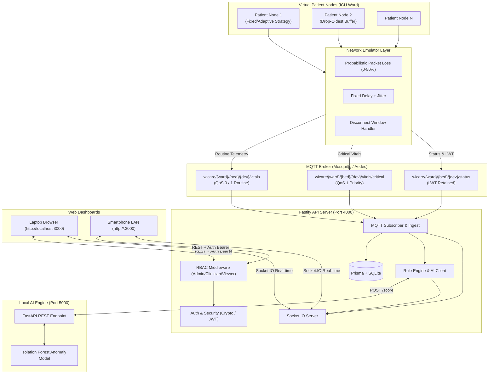
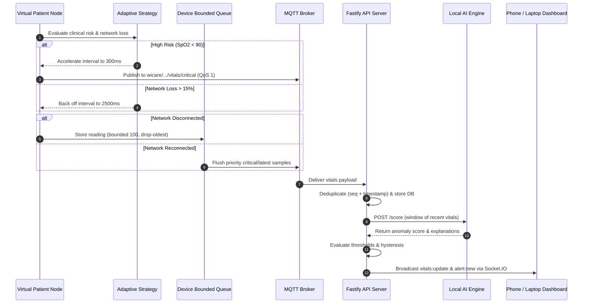

# WiCare System Architecture & Technical Specification

WiCare is a completely local, software-simulated, communication-aware wireless patient-monitoring system. Synthetic vitals produced by independent virtual patient node publishers traverse an MQTT broker, pass through rule-based and local AI anomaly detectors, and stream in real time to Next.js web dashboards on laptops and mobile devices.

---

## 🏗 System Architecture Diagram (Mermaid)

---

## 🔄 End-to-End Prioritized Telemetry Sequence

---

## 🔐 Security & Role-Based Access Control (RBAC)

1. **Authentication**: Passwords stored as `scrypt` hashes (`salt:hash`). Tokens signed using HMAC-SHA256 (`crypto.createHmac`). Zero external dependencies.
2. **Roles & Endpoint Permissions**:
   - `admin`: Can execute simulation control, scenario injection (`POST /simulation/...`), and modify thresholds (`PUT /thresholds/...`).
   - `clinician`: Can acknowledge (`POST /alerts/:id/ack`) and resolve (`POST /alerts/:id/resolve`) clinical alerts.
   - `viewer`: Read-only access to `/patients`, `/readings`, `/alerts`, `/thresholds`.
3. **Socket.IO Handshake Authentication**: Real-time WebSocket connection validates JWT token passed in `auth.token`.

---

## 🌐 Network Scheme & MQTT Topics

| Topic | QoS | Payload | Description |
| :--- | :---: | :--- | :--- |
| `wicare/{ward}/{bed}/{dev}/vitals` | 0 / 1 | `VitalsMessage` | Periodic vital signs (heart rate, SpO2, temp, resp rate). |
| `wicare/{ward}/{bed}/{dev}/vitals/critical` | 1 | `VitalsMessage` | High-priority urgent readings bypassing routine telemetry queue. |
| `wicare/{ward}/{bed}/{dev}/status` | 1 | `StatusMessage` | Connection status (`online` / `offline`) via MQTT Last Will and Testament. |

---

## 📱 LAN Mobile Access

- **Binding**: Both Fastify API (`0.0.0.0:4000`) and Next.js Web App (`0.0.0.0:3000`) listen on all network interfaces.
- **Dynamic URL Discovery**: Server outputs local LAN IP on startup using `os.networkInterfaces()`.
- **CORS Configuration**: API server dynamically accepts origins from any LAN IP (`http://<LAN-IP>:3000`).
- **Dynamic Browser Base URL**: Web dashboard dynamically connects to `http://${window.location.hostname}:4000` for REST & WebSocket requests.
